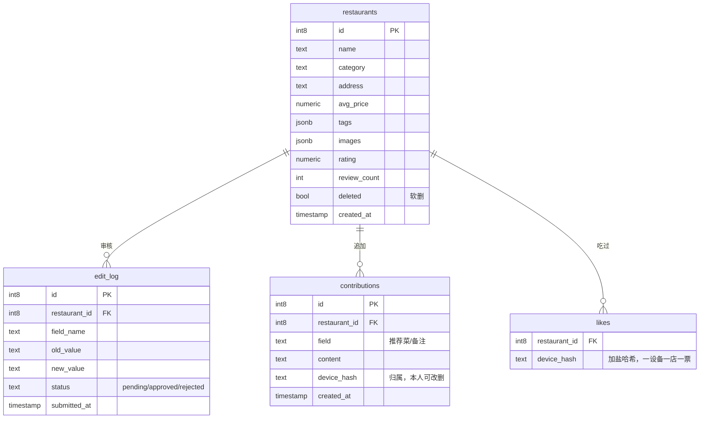
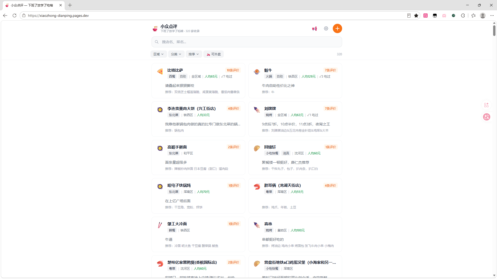
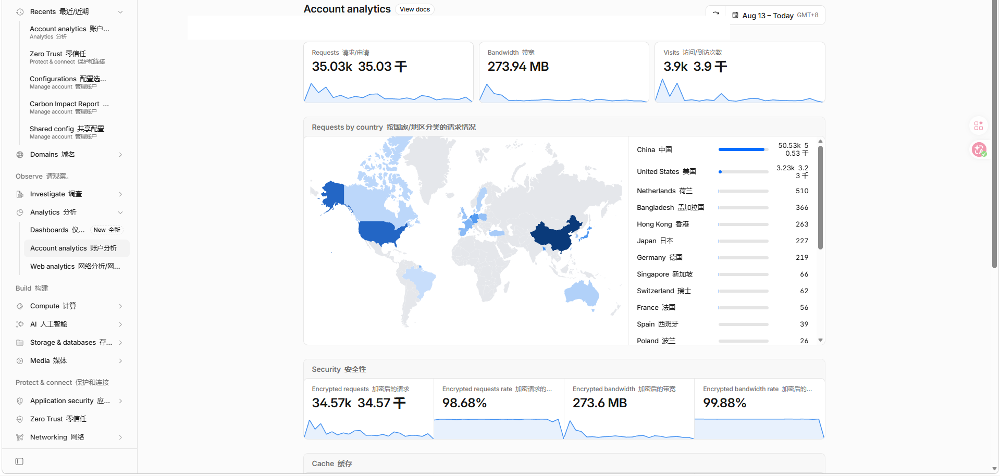

# xiaozhong-dianping 架构设计

沈阳美食推荐平台，已上线运营。群友共建的小众版大众点评。

本仓库公开项目的**全栈架构、安全设计、加固演进和运维经验**，不包含可运行源码。

---

## 系统架构

```mermaid
graph TD
    A[用户浏览器] --> B[Cloudflare Pages<br>Astro SSR/Static]
    B --> C[/api/supabase 透传代理<br>anon key + 最小权限白名单 + 限流]
    C --> D[Supabase PostgreSQL]
    B --> E[/api/upload<br>类型+魔数校验]
    E --> F[Cloudflare R2]
    B --> E2[/img/* 同源代理<br>自定义缓存头 + Content-Type 白名单]
    E2 --> F
    B --> L[/api/like · /api/contribution<br>服务端 service_role + 设备归属]
    L --> D
    B --> G[/api/admin<br>HMAC token 鉴权]
    G --> D

    H[GitHub Actions] -->|单测门禁+类型门禁+密钥扫描| B
    I[管理后台] --> G
```

## 核心设计决策

### 1. 为什么选 Astro + Supabase + Cloudflare Pages

**约束条件**：零成本运营（学生项目无预算）、需要真实用户访问（不是 demo）、需要图片存储、需要数据库、一个人维护（全栈复杂度必须低）。

**选型对比**：

| 方案 | 前端 | 后端 | 数据库 | 图片 | 月成本 | 决策 |
|------|------|------|--------|------|--------|------|
| ✅ 最终方案 | Astro (CF Pages) | CF Pages Functions | Supabase Free | R2 Free | ¥0 | 全免费额度内 |
| 备选A | Next.js (Vercel) | Vercel Serverless | PlanetScale | Vercel Blob | ¥0 | PlanetScale 免费额度取消 |
| 备选B | Vue + Nginx | 自建 VPS | MySQL | 本地 | ~¥50/月 | 学生无预算 |

**Astro 的优势**：默认零 JS 输出（Islands Architecture），首屏极快；只有需要交互的组件（编辑弹窗、评分）才 hydrate React。对内容型站点（餐厅列表）是最优解。

### 2. 安全模型：不依赖"隐藏密钥"，而依赖"纵深防御"

**背景**：早期版本把 Supabase key 直接写进前端，任何人 F12 就能拿到并操作数据库。修复后不是"把 key 藏好"，而是建立多层都假设"上一层可能被突破"的防御。

```
第1层：透传代理 /api/supabase/[...path]（CF Pages Function）
  - 前端只走同域代理；代理注入的是【低权限 anon/publishable key】(存在 CF 环境变量)
  - 最小权限白名单（proxy-guard）：只放行前端确实在用的「表+方法+rpc」——
      三表读、两表 insert 评价/贡献、increment_review_count、仅软删 PATCH
    其余（admin_* rpc、/auth、/storage、任意 DELETE/PUT、未登记表）一律 403
  - 转发前无条件【剥离并重置】apikey/Authorization/Accept-Profile/Content-Profile
    ——防止客户端伪造高权限头或切换 PostgREST schema
  - 每-IP 读写分桶限流（读 120/写 30 每分钟），超限 429 + Retry-After

第2层：Supabase RLS（行级安全，deny-by-default 持续收紧）
  - 公共 UPDATE/DELETE 策略已 DROP，还原/硬删/编辑一律走服务端 service_role
  - increment_review_count 改 SECURITY DEFINER，并显式只授权 anon 执行这一个函数
  - storage.objects 仅放行 review-images 桶的 SELECT/INSERT

第3层：服务端写端点 + Admin 鉴权（service_role 只在这里，绝不进透传代理）
  - /api/like、/api/contribution、/api/admin 用 service_role，缺 env 即 fail-closed（500）
  - Admin 登录密码经恒定时间比较验证；通过后签发【无状态 HMAC token】
    (12h 过期 + HttpOnly cookie)，后续管理操作凭 token 验签，兼容 Workers 无状态运行时
  - 密码/密钥全走 CF Secret（wrangler secret put），轮换后旧凭据立即失效
```

**设计原则**：前端只携带**设计上可公开**的 publishable key；真正的安全不靠"藏 key"，而靠"代理白名单 + RLS deny-by-default + 服务端持 service_role + 限流 + 审计"。service_role 永不出现在透传代理里。

**维护约定**：新增任何浏览器端 Supabase 调用，必须同步在 proxy-guard 登记，否则线上被 403 拦截——把"扩大攻击面"变成一次显式评审。

### 3. 图片存储：R2 + 本站同源代理

**问题**：R2 公共开发域名 `pub-*.r2.dev` 在真实浏览器环境（尤其国内 / 经代理）不可靠，实测浏览器裂图但 curl 却 200；且直链无法自定义缓存头。

**方案**：图片经本站 `/img/<key>` 同源代理回源 R2（Workers R2 Binding），既解决可用性又拿回控制权：

- 上传：前端 canvas 压缩 → `POST /api/upload` → CF Function 校验类型/**文件头魔数**（不只信客户端 MIME）→ 写 R2，文件名用 hash。
- 读取：`/img` 代理设 `Cache-Control: public, max-age=86400, s-maxage=604800, immutable`，交给 CF 边缘缓存（key 为时间戳+随机串、不覆写，可长缓存）。
- **防存储型 XSS**：Content-Type 走白名单（jpeg/png/webp/gif），不优先信任桶内声明的 `contentType`；白名单外（如历史迁移进来的 SVG/HTML）降级为 `application/octet-stream` + `Content-Disposition: attachment`，杜绝在站点同源下被当脚本/文档渲染。

### 4. 用户提交：审核制 + 设备级归属

**问题**：开放编辑 → 垃圾信息/恶意修改；全封闭 → 数据更新全靠一个人。

**方案**：人人可提交，但分流处理。

- **主数据（餐厅字段）修改** → 写 `edit_log`（status=pending）→ 后台审核 approve 合并 / reject 驳回。
- **追加型内容（推荐菜、备注）** → 独立成行存 `contributions` 表，采用"只增不改"：每条带 **device_hash 归属**，只有本人能改/删自己那条（SSR 用 `sf_device_token` cookie 判定）。
- **"吃过"点赞** → 浏览器只发随机设备 token，服务端用 `LIKE_SALT` 做 SHA-256 哈希入库；`(restaurant_id, device_hash)` 数据库唯一约束保证"一设备一店一票"，`Prefer: resolution=ignore-duplicates` 幂等，取消赞按同键删。

**device_hash 模型**：浏览器持随机 token，服务端加盐哈希后落库——既能归属"同一条是本人加的"，又不落任何可识别真人的信息；`LIKE_SALT` 缺失即 fail-closed，绝不用默认/空盐。

### 5. 部署流水线（CI 即门禁）

```
git push → GitHub Actions:
  npm ci → npm test（单测门禁）→ npx astro check（类型门禁）
  → scan-secrets.sh（密钥扫描）→ npm run build → wrangler pages deploy → CF Pages
```

- **单测门禁**：核心 lib/endpoint 有 `.test.mjs`（proxy-guard / admin-auth / contributions / like 等），不过不部署。
- **类型门禁**：用 `astro check`（覆盖 lib / endpoints / frontmatter），而非裸 `tsc --noEmit`；少量内联胶水脚本用 `@ts-nocheck` 显式登记类型债，避免"为了绿而关检查"。
- **密钥扫描**：`scan-secrets.sh` 只对匹配真实密钥格式（`eyJ...`、`sk-...`）的字符串报警，忽略文档说明文字与 `.env.example` 占位值。

**踩坑**：`scan-secrets.sh` 最初把文档里"service_role key"这类说明文字和 `.env.example` 占位值误判为密钥，CI 一直红。修复为"只报警真实密钥格式"。

### 6. 安全加固迭代（v2.2.0 → v2.4.7）

这个产品是被自己当真实项目反复做安全复审、逐版收紧的，不是一次写完。代表性的一轮轮修复：

| 编号 | 风险 | 收口 |
|------|------|------|
| B3 | 透传代理等于开放中继 | 收为最小权限白名单，其余 403 |
| B1/B2 | 后台口令/sessionStorage 在客户端 | 回收站/管理改走服务端 `/api/admin`（service_role + HMAC） |
| #3/#7 | 无限流、盲信客户端 MIME | 全端点每-IP 限流 + 文件头魔数校验 |
| F5 | 一击批量软删全站 | PATCH 必须"单主键等值 `id=eq.<整数>`" |
| F6 | 伪造高权限头冒充 | 转发前无条件剥离重置鉴权/schema 头 |
| F4 | 桶内 SVG/HTML 存储型 XSS | `/img` Content-Type 白名单 + 降级 attachment |
| F11 | 缺安全响应头 | `_headers`(静态) + `middleware.ts`(SSR) 双处注入 HSTS/CSP/X-Frame-DENY/nosniff/… |
| v2.4.7 | 数据库权限过宽 | 撤公共 UPDATE/DELETE 策略、计数改 SECURITY DEFINER、anon 不可执行 admin_* |

这轮的取舍也如实记录：CSP 因站内大量内联脚本，先以 `unsafe-inline` 起步、nonce 改造另列专项；限流是内存级基线缓解（Workers 多 isolate 下非全局强一致），更强限流待上 Cloudflare Rate Limiting 规则。

## 数据模型



## 运维经验

| 事件 | 原因 | 处理 |
|------|------|------|
| Supabase 连接间歇性失败 | Free 计划连接池限制（60 连接） | CF Function 层做连接复用 |
| 图片浏览器裂图（curl 却 200） | R2.dev 直链在国内/代理环境不可靠 + 无缓存控制 | 改走本站 `/img/*` 同源代理 + `immutable` 边缘缓存 |
| 构建后页面空白 | Astro SSR 下 `import.meta.env` 为 undefined | 运行时从 CF 环境变量读取 |
| 早期密钥泄露 | 硬编码进前端 | 轮换 + 迁移 CF Secret + 清理 git 历史 + 建立纵深防御 |

## 已知限制 / 取舍

- Supabase Free 额度：500MB 数据库 + 1GB 文件 + 50K MAU，个人量级远未触及。
- **无正式账号体系**：以匿名 + 设备级归属替代（加盐哈希 + 唯一约束 + 全写端点每-IP 限流 + `edit_log` 审计），能抑制并追溯误操作/恶意刷量；但跨站关联与真人身份识别仍不具备——对个人小工具是合理的隐私/复杂度取舍。
- 单管理员审核，无多角色权限（当前规模够用）。
- 限流为内存级基线，非分布式强限流。


---

## 运营数据（真实线上）

首页由 Supabase 数据库驱动，收录餐厅数实时展示：



Cloudflare 账户分析（Aug 13 – Today）：累计请求 35.03k、带宽 273.94 MB、访问 3.9k：



